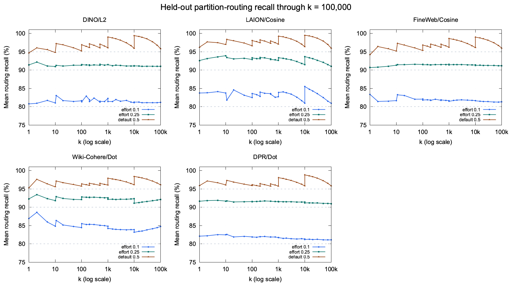

# Search effort recall tiers

`search_effort=0.1` and `0.25` target 80% and 90% average partition-routing
recall. The default `0.5` keeps the existing Auto budget and its nominal 95%
target. Zero and one retain their minimum/all-partitions meanings. Public
parameter types and precedence are unchanged. Fractions of Auto's budget now
depend on both metric and k, so the same effort retains its routing objective
as the requested result count changes.

[Native S3 measurements and interpretation](RESULTS.md) compare the per-k
profiles with the preceding metric-wide policy on the same immutable indices.
They cover FLAT/RQ5, refinement, filtering and cold index caches, with final
Recall@k reported alongside query cost. The `iops` / `Mean IOPS` fields count
read operations per query, not operations per second. The [initial study](RESULTS-initial.md)
is preserved separately and predates the per-k extension.

The implementation scales the existing metric/k-dependent Auto budget and
rounds up to whole partitions. Each metric has two calibrated fractions at
26 selected k anchors. For example:

| Metric | k | Effort 0.1 fraction | Effort 0.25 fraction |
| --- | ---: | ---: | ---: |
| L2 | 1,000 | 0.207 | 0.483 |
| L2 | 100,000 | 0.288 | 0.579 |
| Cosine | 1,000 | 0.161 | 0.432 |
| Cosine | 100,000 | 0.297 | 0.601 |
| Dot | 1,000 | 0.190 | 0.506 |
| Dot | 100,000 | 0.289 | 0.584 |

Fractions interpolate geometrically in log(k). Adjacent anchors on both sides
of each Auto-profile boundary keep interpolation within one underlying profile.

Budgets interpolate geometrically between minimum, 80%, 90%, Auto and maximum
anchors. Explicit caller bounds constrain all anchors. The initial profile cap
does not prevent later probing when too few candidates pass a filter. Hamming
and k>100000 keep their existing uncalibrated interpolation.

## Calibration evidence

The [protocol](PROTOCOL.md) freezes selection and evaluation separately.
[calibration-by-k.json](calibration-by-k.json) records the selected fractions,
exact input hashes and calibration results.
[routing-by-k-evaluation.json](routing-by-k-evaluation.json) records all held-out
results. A 0.001 fraction grid minimizes each k's budget subject to 81%/91%
mean coverage in every calibration corpus of that metric. Calibration-only
anchor selection bounds interpolation overhead to 5% at the check points while
preserving both calibration recall floors. There are no dataset-specific runtime
parameters and no new margin/floor/cap grid. The initial metric-wide study remains
in `calibration.json` and `routing-evaluation.json`.

| Corpus | Metric | Rows | Calibration queries | Held-out queries |
| --- | --- | ---: | ---: | ---: |
| DINO | L2 | 10,000,000 | 2,048 | 4,096 |
| LAION | Cosine | 10,000,000 | 2,048 | 4,093 |
| FineWeb | Cosine | 10,000,000 | 2,048 | 4,096 |
| Wiki-Cohere | Dot | 35,000,000 | 2,500 | 2,500 |
| DPR Wikipedia | Dot | 21,015,300 | 1,805 | 1,805 |

All five corpora have exact Float64 top-100000 oracles and evaluation at
k=1, 2, 5, 10, 11, 20, 50, 100, 101, 150, 200, 201, 300, 500, 501, 750,
1000, 1001, 1500, 2000, 3000, 5000, 7500, 10000, 10001, 15000, 20000,
30000, 50000, 75000 and 100000. Five k values remain interpolated check points:
1500, 3000, 7500, 15000 and 30000.

| Effort | Nominal target | Held-out routing recall range | Groups meeting target |
| --- | ---: | ---: | ---: |
| 0.1 | 80% | 80.762%–88.600% | 155 / 155 |
| 0.25 | 90% | 90.674%–93.926% | 155 / 155 |
| 0.5 | 95% | 94.189%–99.510% | 152 / 155 |



These are strict-ID routing predictions on frozen IVF_FLAT indices, not native
latency measurements or end-to-end RQ recall. The unchanged default misses the
nominal target on DINO k=1/10 and FineWeb k=1. Keep these misses visible.
The matrix does not establish recall for every integer k, other partition counts
or other corpora. Hamming is not calibrated. k>100000 retains legacy probing;
100000 is the calibrated range endpoint, not a maximum allowed result count.

Three repeated LAION vectors are excluded before selection. FineWeb's 256
`reserve` queries are excluded from held-out evaluation. The first preparation
mistakenly admitted these reserve queries; the corrected artifact records the
original frozen hash and verifies unchanged calibration arrays and fractions.
No evaluation result was used to change a parameter. The published result uses
only the original `test` split.

## Reproduce the per-k extension

Use the repository's `python/` environment after `make install`. Each corpus's
input spec records its dataset URI/version, metric, index name/UUID, row count,
existing query NPZ and whether the previous oracle contains row positions or
row IDs. `prepare_large.py` preserves those queries and splits, extracts actual
membership and builds the exact Float64 top-100000 oracle. The spec and source
hashes are saved with the prepared corpus. Dataset specs must refer to the same
immutable indices in preparation and native comparison.

```bash
for corpus in dino laion fineweb wiki-cohere-35m dpr-wikipedia-single-nq; do
  uv run --frozen --no-sync python ../benchmarks/auto-ivf-effort/prepare_large.py \
    "$STUDY/specs/$corpus.json" "$STUDY/prepared/$corpus"
done
uv run --frozen --no-sync python - "$STUDY/prepared" <<'PY'
import json
import sys
from pathlib import Path
root = Path(sys.argv[1])
groups, anchors = [], None
for corpus in ["dino", "laion", "fineweb", "wiki-cohere-35m", "dpr-wikipedia-single-nq"]:
    manifest = json.loads((root / corpus / "manifest.json").read_text())
    current = manifest["mandatory_k_anchors"]
    assert anchors is None or anchors == current
    anchors = current
    groups.extend({**g, "path": f"{corpus}/{g['path']}"} for g in manifest["groups"])
assert len(groups) == 155
(root / "manifest-by-k.json").write_text(json.dumps({
    "groups": groups, "mandatory_k_anchors": anchors
}))
PY
uv run --frozen --no-sync python ../benchmarks/auto-ivf-effort/calibrate.py calibrate \
  "$STUDY/prepared/manifest-by-k.json" "$STUDY/calibration-by-k.json"
uv run --frozen --no-sync python ../benchmarks/auto-ivf-effort/calibrate.py evaluate \
  "$STUDY/prepared/manifest-by-k.json" "$STUDY/calibration-by-k.json" \
  "$STUDY/routing-by-k-evaluation.json"
```

For this run, the mandatory 19 views were prepared first and the 12 extra k
views were derived from the same full oracle and centroid ranking. No ground
truth was recomputed or selected using held-out outcomes. The archived Float32
LAION oracle differed slightly from Float64 scores; an independent Float64
full-sort scan confirmed the new top-100000 oracle. Strict-ID recall is unchanged.

`native.py measure` accepts `--truth <corpus>/truth-rowids.npy`, immutable S3
dataset specs and a JSON plan with `warm`/`cold` lists of
`[index, k, refine_factor, filtered]`. It records binary returned IDs and separate
setup RSS, time and cache reuse. Consecutive warm scenarios on one index reuse
its fully prewarmed session. `audit.py <output> <queries.npz> --truth <truth.npy>`
independently checks hashes, returned IDs, recall, coverage and identical default
results. See the protocol for the full matrix and interpretation limits.

## Reproduce the initial study

Use the scripts at `aff6f1d1a8df56dc72f6b3ab1498086e0688125c` for the commands
below. The current calibrator fits per-k profiles and expects the expanded
matrix; it does not reproduce the initial metric-wide fit.

Use the repository's `python/` environment after `make install`. Restore and
verify these existing campaign archives; `prepare.py` reuses their centroids,
membership and exhaustive oracles rather than rebuilding the calibration matrix:

- OSS-2221: `s3://mmlb-us-east-1/rq-benchmark/results/20260913-auto-recall95/artifacts/ec504126d939/campaign.tar.gz`
  (SHA256 `a3db0628a4a21c1d21c2957458115fc279583369e7654fa7f8fa18d09772bf68`).
- OSS-2249: `s3://mmlb-us-east-1/rq-benchmark/results/oss2249-dot-auto-20260922/evidence.tar.gz`.

The OSS-2221 oracle verifier expects the archived `reproduction-inputs`
directories at their original `/home/ubuntu/` paths. On a fresh benchmark VM,
symlink each archived input directory there. Do not replace existing paths.

```bash
uv run --frozen --no-sync python ../benchmarks/auto-ivf-effort/prepare.py \
  "$RECALL95" "$DOT/evidence" "$STUDY/prepared"
uv run --frozen --no-sync python ../benchmarks/auto-ivf-effort/calibrate.py calibrate \
  "$STUDY/prepared/manifest.json" "$STUDY/calibration.json"
uv run --frozen --no-sync python ../benchmarks/auto-ivf-effort/calibrate.py evaluate \
  "$STUDY/prepared/manifest.json" "$STUDY/calibration.json" "$STUDY/evaluation.json"
```

The separate native experiment uses the frozen DINO S3 IVF_FLAT index and a
task-owned RQ5 clone. `prepare_native.py` verifies the original centroids and
creates the clone without changing source data. `native.py` starts separate
baseline/candidate workers, uses balanced arm order, records CPU/probes/I/O and
strict-ID recall, and checks that default-effort IDs remain identical. See the
protocol for the bounded k/refinement/filter matrix and cold-cache definition.
