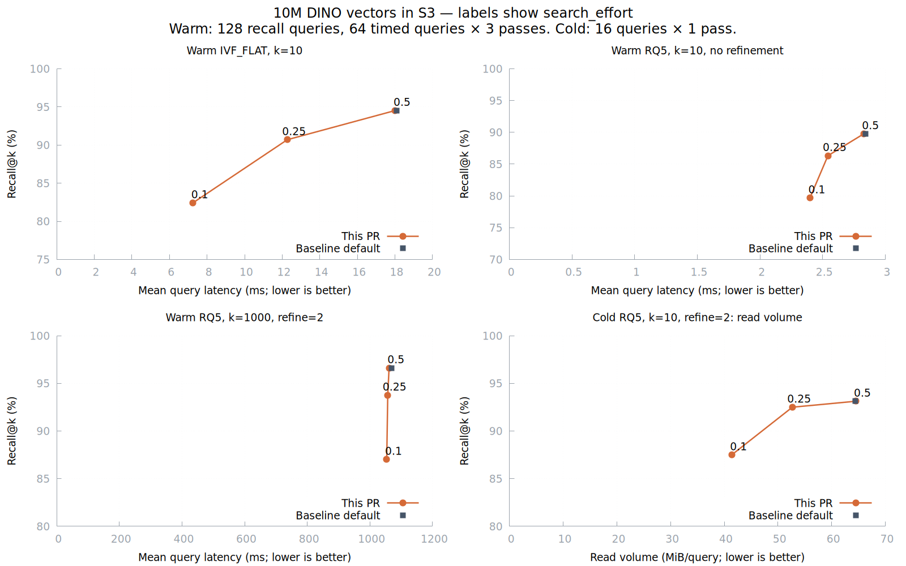

# Native search-effort tradeoffs

This is the initial metric-wide study, preserved for provenance. Its measurements
predate the per-k extension and do not establish performance for the current
coefficients. See [README.md](README.md) for the current calibration evidence.

The new anchors provide calibrated routing targets at lower query cost. The
benefit depends on how much work comes from probing. Refinement and filtering
can dominate the query, and final Recall@k can be below the routing target.

These are policy tradeoffs at different recall levels. Baseline is default effort
0.5 at `b1722c05f29a4cac2a2f76629b77dd6438853628`; the measured feature runtime is
`daf655a75bd3cceedb38b5b198b7e2fd143a30b5`. Subsequent results/documentation
changes preserve the measured product and query-driver code.

## Target levels

The following uses the feature binary with warm index caches. Recall is measured
against exhaustive ground truth, not inferred from the target. Neither index uses
refinement in this table.

| Effort | Routing target | FLAT Recall@10 | FLAT latency | RQ5 Recall@10 | RQ5 latency |
| --- | ---: | ---: | ---: | ---: | ---: |
| 0.1 | 80% mean | 82.422% | 7.245 ms | 79.688% | 2.398 ms |
| 0.25 | 90% mean | 90.703% | 12.267 ms | 86.328% | 2.542 ms |
| 0.5 (default) | 95% mean | 94.531% | 18.009 ms | 89.766% | 2.828 ms |

## Compared with the previous default

Latency and bytes are lower-is-better metrics. Ratios do not represent
equal-recall speedups. Each baseline entry uses the old binary at effort 0.5.

| Scenario / metric | Baseline | This PR | Benefit | Recall: baseline / PR |
| --- | ---: | ---: | ---: | ---: |
| Warm FLAT, k=10, effort=0.1; latency | 18.076 ms | 7.245 ms | 2.50x speedup | 94.531% / 82.422% |
| Warm FLAT, k=10, effort=0.25; latency | 18.076 ms | 12.267 ms | 1.47x speedup | 94.531% / 90.703% |
| Warm RQ5, k=10, no refinement, effort=0.1; latency | 2.840 ms | 2.398 ms | 1.18x speedup | 89.766% / 79.688% |
| Warm RQ5, k=10, no refinement, effort=0.25; latency | 2.840 ms | 2.542 ms | 1.12x speedup | 89.766% / 86.328% |
| Cold RQ5, k=10, refinement=2, effort=0.1; read volume | 64.464 MiB | 41.391 MiB | 1.56x fewer bytes | 93.125% / 87.500% |
| Cold RQ5, k=10, refinement=2, effort=0.25; read volume | 64.464 MiB | 52.680 MiB | 1.22x fewer bytes | 93.125% / 92.500% |
| Warm RQ5, k=1000, refinement=2, effort=0.1; latency | 1069.460 ms | 1053.526 ms | 1.02x; little change | 96.623% / 87.027% |

## Interpretation and limits

- Warm FLAT shows the clearest latency benefit: the 80% routing tier reduces mean
  probes from 12.39 to 3.84 and CPU from 17.13 ms to 6.72 ms. Warm RQ5 without
  refinement has a smaller query-time benefit despite the same probe reduction.
- At k=1000 with refinement=2, all tiers still perform about 1993 read operations
  and read 8.04 MiB per query. CPU stays near 274 ms and latency near 1.06 s.
  Lowering effort mainly trades away quality in this case.
- The `_rowid % 10 = 0` prefilter case spends about 175 ms of CPU per query and
  still reads 20 original vectors. Feature latency is about 221 ms at every tier,
  while Recall@10 changes from 92.422% at default to 87.422%/75.547% at effort
  0.25/0.1. The unfiltered routing targets do not promise filtered recall.
- Cold RQ5 reads fewer bytes and performs fewer read operations, but its latency
  sample contains an outlier. Baseline query 92985 took 10576.136 ms; the unchanged
  feature default took 1871.779 ms with identical 20 probes, 84268621 bytes, 328
  read operations and 47 coalesced scan requests. The raw cold-RQ latency ratio is
  not evidence of a probing-policy speedup. The cold plot shows read volume.
- Existing low effort values change meaning. On warm FLAT, old effort 0.25 returned
  80.547% recall in 7.038 ms; new 0.25 returns 90.703% in 12.267 ms (1.74x latency).
  New 0.1 is near that old operating point, at 82.422% recall and 7.245 ms. The
  feature supplies calibrated targets, not a free improvement at the same quality.

Use 0.25 for a less aggressive routing-cost reduction and 0.1 when lower quality
is acceptable. Check final recall on the intended index and filters. Retaining
default effort is sensible when refinement or predicate processing dominates.

## Measurement contract

- AWS r8i.8xlarge, Intel Xeon 6975P-C, 32 vCPU / 256 GiB RAM; CPU affinity 0–15,
  Lance/Rayon 16 threads and BLAS/OMP 1 thread. Builds and other benchmarks finished
  before measurement.
- DINO: 10000000 Float32 vectors, 1024 dimensions, L2, 40 fragments and 2441
  partitions. Both binaries use the same immutable S3 dataset versions and index
  segments. RQ5 uses the frozen FLAT centroids, fast rotation, packed 5-bit storage
  and the raw-query estimator.
- Rust 1.98.1, repository `release-with-debug` profile and its
  Haswell/AVX2/FMA/F16C settings. Exact binary, data and query identities are in
  [native-identity.json](native-identity.json).
- Warm index cache capacity is 48 GiB per process. Cold samples open a fresh
  dataset/session with index cache capacity zero for every query. This does not
  reset S3's internal cache. Refinement can read original vectors with a warm
  index cache.
- The first 128 original held-out queries contribute recall; the first 64 are
  timed in three balanced passes. Eight different held-out queries are warmups.
  Each cold scenario uses the first 16 queries in one pass.
- Latency/CPU/I/O summaries use one median per timed query, then mean/p50/p95
  across queries. Cold values use one observation per query. Sequential QPS uses
  all measured query wall times and excludes driver IPC. Timing includes scanner
  construction and result-table collection; cold timing also includes dataset
  opening. These percentiles are not production tail-latency guarantees.
- Recall is independently recomputed from IDs against the archived exhaustive
  top-4096 oracle. The filtered reference contains at least k eligible neighbors.
  Missing/tied IDs count as misses. Every arm has the same query coverage, and
  every default query returns identical IDs across binaries.
- The audit checks all 7872 records across 42 groups.
  [native-summary.csv](native-summary.csv) includes old and new arms at the same
  effort, recall, latency, throughput, probes, bytes, CPU and I/O. Read-operation
  counts are not operations per second; scan requests can be coalesced.

The [routing study](README.md) separately evaluates all three metrics and retains
its default-target misses. These native measurements establish the listed DINO
workload, not every metric, k, index or production router. SDK/Sophon release
adoption and integrated acceptance remain separate.

Raw records, frozen inputs, binaries and validation logs are retained under
`s3://mmlb-us-east-1/rq-benchmark/results/t190-recall-tiers-20261104/` (private).
