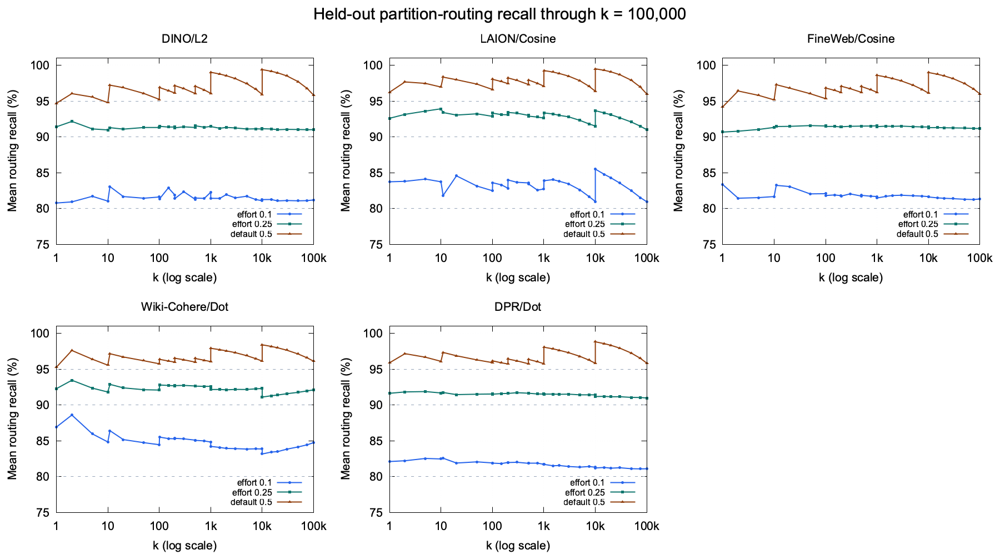

# Native search effort by metric and k

The per-k profiles keep the two lower routing objectives useful as the requested result count changes. All 155 full held-out corpus/k groups meet the 80% and 90% routing goals. The native comparison independently audits 83,616 query records across 366 groups, including all three metrics through k=100000. Default-effort returned IDs are identical for every paired native query.

This extension compares the previous metric-wide policy at `aff6f1d1a8df56dc72f6b3ab1498086e0688125c` with measured source `8d5cb16ec558790537bcdb2e189ff96256e2247b`. The preserved parent binary was built from source `daf655a75bd3cceedb38b5b198b7e2fd143a30b5`; a checked file diff establishes that aff6 changes only reporting/docs. The [initial study](RESULTS-initial.md) against b1722c05 remains historical evidence.

These are quality/cost changes, not equal-recall speedups. The new policy can do more work at large k to reach its routing objective, and less work near the bottom of a wide Auto bucket. The comparison tables retain both directions and show recall next to latency. Small timing ratios should not be interpreted as stable benefits; the unchanged-default controls below show measurement variation.

## Quality and coverage

| Effort | Routing goal | Full routing groups meeting goal | Native FLAT recall range | Native FLAT groups meeting goal |
| --- | --- | --- | --- | --- |
| 0.1 | 80.000% mean | 155 / 155 | 78.125% to 86.719% | 48 / 50 |
| 0.25 | 90.000% mean | 155 / 155 | 90.462% to 96.094% | 50 / 50 |
| 0.5 | 95.000% mean | 152 / 155 | 93.750% to 99.594% | 47 / 50 |

The routing matrix uses the full original held-out sets (1,805 to 4,096 queries per corpus) at 31 k values. Native FLAT quality uses 128 fixed held-out queries at 10 k values per corpus. These populations and metrics differ: routing coverage is not a guarantee for every query, subset, or final Recall@k. The unchanged default retains the original DINO k=1/10 and FineWeb k=1 full-matrix misses.

Native warm-FLAT groups below a nominal goal are retained below. Their frozen predictions use the exact same native query IDs, without refitting. This distinguishes a subset mean from an implementation discrepancy. A full-matrix default miss remains a miss.

| Corpus | k | Effort | Full held-out routing recall | Same native subset prediction | Native Recall@k | Classification |
| --- | --- | --- | --- | --- | --- | --- |
| Wiki-Cohere | 10 | 0.5 | 95.568% | 94.688% | 94.688% | native subset target miss |
| DPR | 1 | 0.1 | 82.105% | 79.688% | 79.688% | native subset target miss |
| DINO | 1 | 0.1 | 80.762% | 78.125% | 78.125% | native subset target miss |
| DINO | 10 | 0.5 | 94.788% | 94.531% | 94.531% | full heldout target miss |
| FineWeb | 1 | 0.5 | 94.189% | 93.750% | 93.750% | full heldout target miss |

## Large-k comparison

The baseline and current arms below use the same effort. Lower latency is better; every ratio is calculated from the measured values and must be read together with recall.

| Scenario / metric | Baseline | This PR | Benefit | Recall: baseline / PR |
| --- | ---: | ---: | ---: | ---: |
| wiki-cohere-35m, warm flat, k=100000, effort=0.1; latency (lower is better) | 498.262 ms | 833.115 ms | 1.67x slower | 77.180% / 85.260% |
| wiki-cohere-35m, warm flat, k=100000, effort=0.25; latency (lower is better) | 1202.965 ms | 1584.972 ms | 1.32x slower | 90.014% / 92.608% |
| dpr-wikipedia-single-nq, warm flat, k=100000, effort=0.1; latency (lower is better) | 256.202 ms | 388.861 ms | 1.52x slower | 69.409% / 80.830% |
| dpr-wikipedia-single-nq, warm flat, k=100000, effort=0.25; latency (lower is better) | 546.830 ms | 687.212 ms | 1.26x slower | 87.366% / 90.924% |
| dino, warm flat, k=100000, effort=0.1; latency (lower is better) | 273.176 ms | 277.401 ms | 1.02x slower | 81.742% / 81.886% |
| dino, warm flat, k=100000, effort=0.25; latency (lower is better) | 486.089 ms | 475.693 ms | 1.02x ratio (small) | 91.736% / 91.390% |
| laion, warm flat, k=100000, effort=0.1; latency (lower is better) | 289.625 ms | 298.486 ms | 1.03x slower | 80.243% / 81.234% |
| laion, warm flat, k=100000, effort=0.25; latency (lower is better) | 499.307 ms | 516.540 ms | 1.03x slower | 90.362% / 91.164% |
| fineweb, warm flat, k=100000, effort=0.1; latency (lower is better) | 297.091 ms | 309.471 ms | 1.04x slower | 79.161% / 80.251% |
| fineweb, warm flat, k=100000, effort=0.25; latency (lower is better) | 512.729 ms | 537.828 ms | 1.05x slower | 89.680% / 90.462% |

## Auto bucket boundaries

The k=1001 and k=10001 cases expose excessive work from applying one fraction across a wide bucket. The per-k policy trades that extra recall for the requested lower routing objective.

| Scenario / metric | Baseline | This PR | Benefit | Recall: baseline / PR |
| --- | ---: | ---: | ---: | ---: |
| wiki-cohere-35m, warm flat, k=1001, effort=0.1; latency (lower is better) | 193.768 ms | 126.480 ms | 1.53x speedup | 88.818% / 84.809% |
| wiki-cohere-35m, warm flat, k=1001, effort=0.25; latency (lower is better) | 518.905 ms | 324.489 ms | 1.60x speedup | 95.359% / 92.737% |
| wiki-cohere-35m, warm flat, k=10001, effort=0.1; latency (lower is better) | 411.231 ms | 254.215 ms | 1.62x speedup | 88.761% / 83.843% |
| wiki-cohere-35m, warm flat, k=10001, effort=0.25; latency (lower is better) | 1111.626 ms | 582.638 ms | 1.91x speedup | 95.807% / 91.774% |
| dpr-wikipedia-single-nq, warm flat, k=1001, effort=0.1; latency (lower is better) | 85.610 ms | 57.566 ms | 1.49x speedup | 86.869% / 81.447% |
| dpr-wikipedia-single-nq, warm flat, k=1001, effort=0.25; latency (lower is better) | 220.233 ms | 138.222 ms | 1.59x speedup | 95.029% / 91.697% |
| dpr-wikipedia-single-nq, warm flat, k=10001, effort=0.1; latency (lower is better) | 177.249 ms | 109.993 ms | 1.61x speedup | 87.078% / 80.397% |
| dpr-wikipedia-single-nq, warm flat, k=10001, effort=0.25; latency (lower is better) | 458.578 ms | 244.251 ms | 1.88x speedup | 95.784% / 90.929% |
| dino, warm flat, k=1001, effort=0.1; latency (lower is better) | 55.699 ms | 16.383 ms | 3.40x speedup | 95.526% / 82.050% |
| dino, warm flat, k=1001, effort=0.25; latency (lower is better) | 111.216 ms | 33.599 ms | 3.31x speedup | 98.462% / 91.999% |
| dino, warm flat, k=10001, effort=0.1; latency (lower is better) | 199.683 ms | 47.482 ms | 4.21x speedup | 96.374% / 81.362% |
| dino, warm flat, k=10001, effort=0.25; latency (lower is better) | 408.418 ms | 100.407 ms | 4.07x speedup | 98.720% / 91.275% |
| laion, warm flat, k=1001, effort=0.1; latency (lower is better) | 68.096 ms | 18.666 ms | 3.65x speedup | 95.995% / 83.670% |
| laion, warm flat, k=1001, effort=0.25; latency (lower is better) | 134.234 ms | 45.348 ms | 2.96x speedup | 98.189% / 93.842% |
| laion, warm flat, k=10001, effort=0.1; latency (lower is better) | 209.963 ms | 66.719 ms | 3.15x speedup | 95.418% / 85.472% |
| laion, warm flat, k=10001, effort=0.25; latency (lower is better) | 415.267 ms | 155.982 ms | 2.66x speedup | 98.425% / 93.862% |
| fineweb, warm flat, k=1001, effort=0.1; latency (lower is better) | 98.217 ms | 26.087 ms | 3.76x speedup | 94.011% / 81.668% |
| fineweb, warm flat, k=1001, effort=0.25; latency (lower is better) | 193.002 ms | 65.139 ms | 2.96x speedup | 97.092% / 91.405% |
| fineweb, warm flat, k=10001, effort=0.1; latency (lower is better) | 214.902 ms | 69.521 ms | 3.09x speedup | 93.089% / 80.984% |
| fineweb, warm flat, k=10001, effort=0.25; latency (lower is better) | 426.110 ms | 162.483 ms | 2.62x speedup | 97.014% / 90.896% |

## Choosing an effort

The following DINO k=1000 measurements all use the current binary. They compare the same three choices on FLAT and RQ5 with refinement=2.

| Effort | Routing goal | FLAT Recall@1000 | FLAT latency | RQ5 / refine2 Recall@1000 | RQ5 / refine2 latency |
| --- | --- | --- | --- | --- | --- |
| 0.1 | 80.000% mean | 83.462% | 17.412 ms | 83.225% | 988.371 ms |
| 0.25 | 90.000% mean | 92.306% | 34.241 ms | 92.237% | 988.036 ms |
| 0.5 | 95.000% mean | 96.702% | 65.907 ms | 96.623% | 998.920 ms |

Choose 0.25 for the 90% routing objective or 0.1 when the lower 80% objective is acceptable, then check final recall on the intended index and filters. At this k, reducing effort from 0.5 to 0.1 changes the refined query's mean probes from 50.02 to 11.19, but it still reads 8.029 MiB in 1992.92 operations per query. Lower initial routing work does not remove the original-vector fetch and refinement cost.

## Refinement, filtering and quantization

The warm DINO RQ5 controls use the full 128-query recall / 64-query timing sample; the cold control uses 16 queries. Refinement and the row-ID prefilter can add work or change final recall independently of initial partition routing. The raw summaries retain same-effort parent measurements as well.

| Cache / scenario | Effort | Recall@k | Mean latency | Mean CPU | Mean probes | Mean read volume | Mean read ops |
| --- | --- | --- | --- | --- | --- | --- | --- |
| cold, k=10, refine=2 | 0.1 | 87.500% | 1754.164 ms | 197.656 ms | 3.88 partitions | 41.391 MiB | 111.69 ops |
| cold, k=10, refine=2 | 0.25 | 91.250% | 1702.081 ms | 221.983 ms | 7.94 partitions | 52.351 MiB | 172.50 ops |
| cold, k=10, refine=2 | 0.5 | 93.125% | 1801.006 ms | 254.484 ms | 12.56 partitions | 64.465 MiB | 229.13 ops |
| warm, k=10, refine=0 | 0.1 | 79.688% | 2.335 ms | 2.061 ms | 3.84 partitions | 0.000 MiB | 0.00 ops |
| warm, k=10, refine=0 | 0.25 | 86.250% | 2.271 ms | 2.241 ms | 7.88 partitions | 0.000 MiB | 0.00 ops |
| warm, k=10, refine=0 | 0.5 | 89.766% | 2.535 ms | 2.478 ms | 12.39 partitions | 0.000 MiB | 0.00 ops |
| warm, k=10, refine=2 | 0.1 | 82.188% | 94.546 ms | 8.272 ms | 3.84 partitions | 0.078 MiB | 20.00 ops |
| warm, k=10, refine=2 | 0.25 | 90.469% | 78.551 ms | 8.204 ms | 7.88 partitions | 0.078 MiB | 20.00 ops |
| warm, k=10, refine=2 | 0.5 | 94.531% | 86.693 ms | 8.380 ms | 12.39 partitions | 0.078 MiB | 20.00 ops |
| warm, k=10, refine=2, filter=10% | 0.1 | 75.547% | 236.770 ms | 173.989 ms | 3.84 partitions | 0.078 MiB | 20.00 ops |
| warm, k=10, refine=2, filter=10% | 0.25 | 87.422% | 232.942 ms | 174.094 ms | 7.88 partitions | 0.078 MiB | 20.00 ops |
| warm, k=10, refine=2, filter=10% | 0.5 | 92.422% | 232.610 ms | 174.422 ms | 12.39 partitions | 0.078 MiB | 20.00 ops |
| warm, k=1000, refine=2 | 0.1 | 83.225% | 988.371 ms | 267.176 ms | 11.19 partitions | 8.029 MiB | 1992.92 ops |
| warm, k=1000, refine=2 | 0.25 | 92.237% | 988.036 ms | 265.353 ms | 24.84 partitions | 8.042 MiB | 1992.69 ops |
| warm, k=1000, refine=2 | 0.5 | 96.623% | 998.920 ms | 266.977 ms | 50.02 partitions | 8.041 MiB | 1992.91 ops |

The k=100000 RQ5 diagnostic has no refinement and uses only 16 queries with one timed pass. It is reported separately and does not replace the full FLAT matrix.

| Binary | Effort | Recall@100000 | Mean latency | Mean probes | Mean read volume |
| --- | --- | --- | --- | --- | --- |
| baseline | 0.1 | 84.195% | 123.777 ms | 157.00 partitions | 0.000 GiB |
| baseline | 0.25 | 93.636% | 149.555 ms | 329.50 partitions | 0.000 GiB |
| baseline | 0.5 | 96.247% | 167.506 ms | 546.94 partitions | 0.000 GiB |
| candidate | 0.1 | 84.313% | 123.346 ms | 158.06 partitions | 0.000 GiB |
| candidate | 0.25 | 93.289% | 147.229 ms | 317.38 partitions | 0.000 GiB |
| candidate | 0.5 | 96.247% | 168.195 ms | 546.94 partitions | 0.000 GiB |

## Cold index-cache sample

Each arm/query opens a fresh dataset/session with index-cache capacity zero. This does not control S3's internal caches or represent a fresh Python process. These 16-query, one-pass samples report actual storage counters. No cold-latency improvement is inferred solely from a smaller partition count.

| Corpus | Effort | Recall: baseline / PR | Read volume: baseline / PR | Read ops: baseline / PR | Latency: baseline / PR |
| --- | --- | --- | --- | --- | --- |
| Wiki-Cohere | 0.1 | 78.149% / 85.918% | 5.141 GiB / 9.167 GiB | 941.94 / 1652.19 ops | 9674.719 ms / 16905.345 ms |
| Wiki-Cohere | 0.25 | 90.448% / 92.845% | 13.978 GiB / 18.518 GiB | 2494.19 / 3285.88 ops | 23165.035 ms / 31068.453 ms |
| Wiki-Cohere | 0.5 | 96.583% / 96.583% | 31.726 GiB / 31.726 GiB | 5584.63 / 5584.56 ops | 52134.941 ms / 52239.913 ms |
| DPR | 0.1 | 68.206% / 79.240% | 2.277 GiB / 3.998 GiB | 439.25 / 749.31 ops | 5119.548 ms / 8036.521 ms |
| DPR | 0.25 | 86.563% / 90.215% | 6.045 GiB / 7.957 GiB | 1117.50 / 1462.06 ops | 11318.371 ms / 14246.447 ms |
| DPR | 0.5 | 95.661% / 95.661% | 13.446 GiB / 13.446 GiB | 2450.38 / 2450.13 ops | 23796.601 ms / 23505.272 ms |
| DINO | 0.1 | 84.287% / 84.410% | 2.520 GiB / 2.536 GiB | 431.56 / 434.38 ops | 4692.594 ms / 4964.068 ms |
| DINO | 0.25 | 94.380% / 93.973% | 5.256 GiB / 5.060 GiB | 865.00 / 834.56 ops | 8073.193 ms / 7764.177 ms |
| DINO | 0.5 | 97.684% / 97.684% | 8.681 GiB / 8.681 GiB | 1407.63 / 1407.25 ops | 12645.199 ms / 12790.885 ms |
| LAION | 0.1 | 80.844% / 81.609% | 2.504 GiB / 2.676 GiB | 482.75 / 513.06 ops | 5575.183 ms / 5829.071 ms |
| LAION | 0.25 | 90.353% / 91.162% | 5.049 GiB / 5.398 GiB | 936.81 / 997.94 ops | 9726.307 ms / 10775.944 ms |
| LAION | 0.5 | 95.388% / 95.388% | 8.974 GiB / 8.974 GiB | 1635.38 / 1635.19 ops | 16747.507 ms / 17224.894 ms |
| FineWeb | 0.1 | 82.327% / 83.359% | 2.559 GiB / 2.729 GiB | 504.94 / 536.38 ops | 5956.819 ms / 6141.281 ms |
| FineWeb | 0.25 | 91.663% / 92.402% | 5.160 GiB / 5.515 GiB | 979.88 / 1043.31 ops | 10280.735 ms / 10967.533 ms |
| FineWeb | 0.5 | 96.599% / 96.599% | 9.203 GiB / 9.203 GiB | 1710.25 / 1710.44 ops | 18048.584 ms / 17648.097 ms |

The DPR effort=0.1 cold sample at k=100000 has 79.240% recall on 16 queries. The frozen model predicts exactly 79.240% recall and 329.75 mean probes on those same query IDs, matching the native run. The full held-out mean is 81.097%, and the 128-query warm native mean is 80.830%. This smaller subset miss is retained without retuning; its input hash and prediction are recorded in the identity file.

## Controls and reproducibility

Both binaries run on one AWS r8i.8xlarge (Intel Xeon 6975P-C, 32 vCPU, 247 GiB observed RAM, one NUMA node) with Rust 1.98.1 and `release-with-debug`. CPU affinity is 0-15, Lance/Rayon use 16 threads, and BLAS/OMP use one. Queries are serial with `query_parallelism=1`. Both workers have 112 GiB of index-cache capacity. Consecutive warm scenarios reuse their prewarmed index session.

| Corpus | Metric | Rows | Dimensions | Partitions | Fragments | Version |
| --- | --- | --- | --- | --- | --- | --- |
| Wiki-Cohere | dot | 35,000,000 | 768 | 8545 | 34 | 2 |
| DPR | dot | 21,015,300 | 768 | 5131 | 21 | 2 |
| DINO | l2 | 10,000,000 | 1024 | 2441 | 40 | 3 |
| LAION | cosine | 10,000,000 | 768 | 2441 | 10 | 3 |
| FineWeb | cosine | 10,000,000 | 768 | 2441 | 40 | 4 |

All source vectors are Float32; the oracle is exhaustive Float64 with strict-ID recall. LAION's old Float32 prefix discrepancy was checked independently by a full Float64 scan/sort, without replacing strict-ID recall with tie forgiveness. The Dot indices were rebuilt from pinned public sources and original centroids, with actual membership recorded; both native binaries use the same rebuilt S3 versions and UUIDs.

| Study | Baseline post-prewarm RSS | Candidate post-prewarm RSS | Full measurement job wall time |
| --- | --- | --- | --- |
| Wiki-Cohere | 102.666 GiB | 103.206 GiB | 199.66 min |
| DPR | 62.660 GiB | 62.828 GiB | 88.27 min |
| DINO | 39.810 GiB | 39.739 GiB | 48.67 min |
| LAION | 30.865 GiB | 30.842 GiB | 56.62 min |
| FineWeb | 31.002 GiB | 31.005 GiB | 64.08 min |
| dino-rq | 7.315 GiB | 7.512 GiB | 39.51 min |
| dino-rq-large | 7.472 GiB | 7.480 GiB | 0.75 min |

RSS above is observed after setup/prewarm, not a serialized-size estimate or a peak-memory guarantee. Full job wall time includes worker startup, prewarm, warmups, recall-only queries, ID recording and final hashes; it excludes the subsequent independent audit. The reported per-query timer includes the native scanner call (and fresh dataset opening in cold mode), while oracle matching and parent/worker IPC are outside that timer.

Latency is the mean of per-query medians over three balanced passes on 64 queries. Recall gives each of 128 queries equal weight. Cold and the RQ k100000 diagnostic use one pass on 16 queries. Sequential query QPS divides timed calls by their summed measured wall time, excluding driver IPC. Read operations are counts per query, not operations per second.

The unchanged-default baseline/current latency ratio ranges from 0.950x to 1.022x in warm groups, and 0.972x to 1.073x in cold groups. Default IDs, recall and probe counts match across binaries. No default speedup is attributed to the new policy.

Native library SHA256:

- Parent: `a2768f4f90982f7c1723dac0176e60c2a27f294ba69dc244fb8d071165228e3d`.
- Measured implementation: `12bfb45f08af186d3d0b69846e799b1ada59df7ced90f7a029fa3a62de5dde43`.

[All native summaries](native-by-k-summary.csv) include latency/CPU quantiles, probe and comparison counts, read volume/operations and timed query QPS. [Identities and audit overview](native-by-k-identity.json) preserve immutable dataset versions, query IDs, cache settings, source/binary hashes and all audit results. The [protocol](PROTOCOL.md) and [calibration evidence](README.md) describe selection separately from evaluation.

Full oracles, inputs, raw returned IDs, query records, binaries and logs are retained under `s3://mmlb-us-east-1/rq-benchmark/results/t190-k100000-20261104/`, with full-stream SHA256 verification recorded in `archive-SHA256SUMS`. Frozen Dot fixtures and the DINO RQ fixture are retained for release-dependent consumer acceptance. Hamming and k>100000 remain uncalibrated legacy behavior. This study is not SDK/Sophon adoption or production acceptance.
