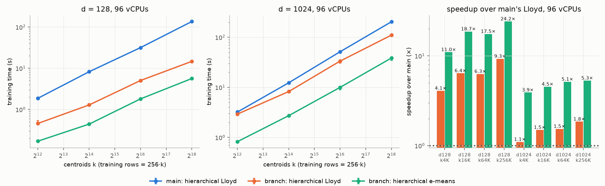
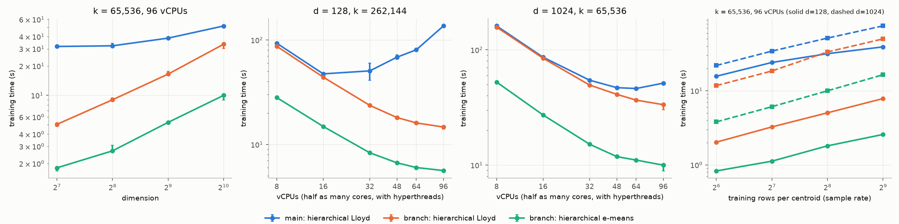
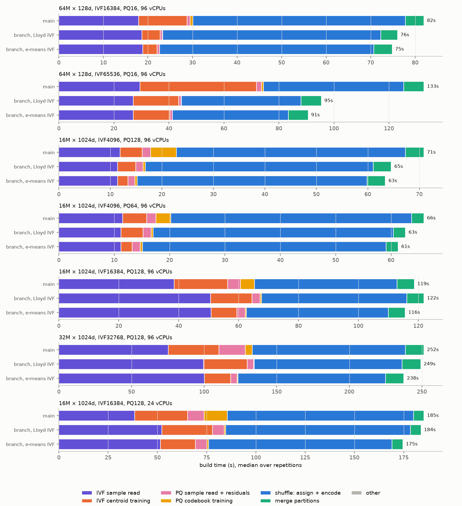
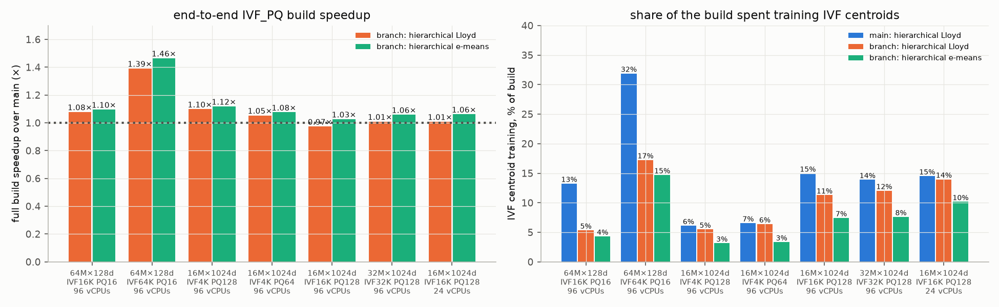

# Centroid training and full IVF_PQ builds

## Centroid training

| d | k | rows/centroid | vCPUs | main Lloyd (s) | branch Lloyd (s) | branch e-means (s) | Lloyd speedup | e-means vs main | e-means vs branch Lloyd | val MSE e-means / main |
|---|---|---|---|---|---|---|---|---|---|---|
| 128 | 4,096 | 256 | 96 | 1.9 | 0.5 | 0.2 | 4.1× | 11.0× | 2.7× | 0.9982 (n=3) |
| 128 | 16,384 | 256 | 96 | 8.2 | 1.3 | 0.4 | 6.4× | 18.7× | 2.9× | 0.9963 (n=3) |
| 128 | 65,536 | 64 | 96 | 15.7 | 2.0 | 0.8 | 7.8× | 19.0× | 2.4× | 0.9964 (n=2) |
| 128 | 65,536 | 128 | 96 | 24.1 | 3.2 | 1.1 | 7.4× | 21.5× | 2.9× | 0.9994 (n=2) |
| 128 | 65,536 | 256 | 96 | 31.7 | 5.0 | 1.8 | 6.3× | 17.5× | 2.8× | 1.0004 (n=3) |
| 128 | 65,536 | 512 | 96 | 39.1 | 7.8 | 2.6 | 5.0× | 15.2× | 3.0× | 0.9984 (n=2) |
| 128 | 262,144 | 256 | 8 | 93.0 | 87.0 | 28.1 | 1.1× | 3.3× | 3.1× | 0.9979 (n=2) |
| 128 | 262,144 | 256 | 16 | 47.4 | 44.1 | 14.9 | 1.1× | 3.2× | 3.0× | 0.9979 (n=2) |
| 128 | 262,144 | 256 | 32 | 50.6 | 23.7 | 8.3 | 2.1× | 6.1× | 2.8× | 0.9979 (n=2) |
| 128 | 262,144 | 256 | 48 | 68.4 | 18.1 | 6.7 | 3.8× | 10.2× | 2.7× | 0.9979 (n=2) |
| 128 | 262,144 | 256 | 64 | 80.5 | 16.1 | 6.0 | 5.0× | 13.4× | 2.7× | 0.9979 (n=2) |
| 128 | 262,144 | 256 | 96 | 136.3 | 14.7 | 5.6 | 9.3× | 24.2× | 2.6× | 0.9984 (n=3) |
| 256 | 65,536 | 256 | 96 | 32.2 | 9.0 | 2.7 | 3.6× | 11.9× | 3.3× | 1.0000 (n=3) |
| 512 | 65,536 | 256 | 96 | 38.6 | 16.5 | 5.3 | 2.3× | 7.3× | 3.1× | 0.9996 (n=3) |
| 1024 | 4,096 | 256 | 96 | 3.2 | 2.9 | 0.8 | 1.1× | 3.9× | 3.6× | 0.9990 (n=3) |
| 1024 | 16,384 | 256 | 96 | 12.3 | 8.2 | 2.7 | 1.5× | 4.5× | 3.0× | 0.9979 (n=3) |
| 1024 | 65,536 | 64 | 96 | 21.9 | 11.7 | 3.8 | 1.9× | 5.8× | 3.1× | 0.9973 (n=2) |
| 1024 | 65,536 | 128 | 96 | 34.3 | 18.5 | 6.1 | 1.9× | 5.6× | 3.0× | 0.9985 (n=2) |
| 1024 | 65,536 | 256 | 8 | 161.2 | 157.4 | 52.5 | 1.0× | 3.1× | 3.0× | 0.9996 (n=2) |
| 1024 | 65,536 | 256 | 16 | 86.3 | 84.6 | 27.2 | 1.0× | 3.2× | 3.1× | 0.9996 (n=2) |
| 1024 | 65,536 | 256 | 32 | 54.5 | 49.5 | 15.2 | 1.1× | 3.6× | 3.3× | 0.9996 (n=2) |
| 1024 | 65,536 | 256 | 48 | 47.0 | 41.1 | 11.8 | 1.1× | 4.0× | 3.5× | 0.9996 (n=2) |
| 1024 | 65,536 | 256 | 64 | 46.1 | 36.6 | 11.1 | 1.3× | 4.2× | 3.3× | 0.9996 (n=2) |
| 1024 | 65,536 | 256 | 96 | 51.4 | 33.4 | 10.0 | 1.5× | 5.1× | 3.3× | 1.0003 (n=3) |
| 1024 | 65,536 | 512 | 96 | 75.1 | 50.2 | 16.5 | 1.5× | 4.6× | 3.0× | 0.9986 (n=2) |
| 1024 | 262,144 | 256 | 96 | 204.2 | 110.4 | 38.5 | 1.8× | 5.3× | 2.9× | 0.9982 (n=3) |

## Full IVF_PQ builds

| configuration | variant | build (s) | speedup | IVF sample | IVF train | PQ prep | PQ train | shuffle | merge | peak RSS (GB) | recall@10 (nprobes, refine) |
|---|---|---|---|---|---|---|---|---|---|---|---|
| 64M × 128d, IVF16384, PQ16, 96 vCPUs | main: hierarchical Lloyd (n=2) | 82.0 | 1.00× | 17.9 | 10.9 | 0.7 | 0.6 | 47.7 | 4.1 | 10 | 0.441 (64,0), 0.909 (64,10), 0.441 (256,0), 0.913 (256,10) |
| 64M × 128d, IVF16384, PQ16, 96 vCPUs | branch: hierarchical Lloyd (n=2) | 76.1 | 1.08× | 18.7 | 4.1 | 0.5 | 0.0 | 49.0 | 3.7 | 15 | 0.443 (64,0), 0.907 (64,10), 0.443 (256,0), 0.911 (256,10) |
| 64M × 128d, IVF16384, PQ16, 96 vCPUs | branch: hierarchical e-means (n=2) | 74.9 | 1.10× | 18.9 | 3.2 | 0.5 | 0.0 | 48.1 | 4.1 | 14 | 0.437 (64,0), 0.904 (64,10), 0.437 (256,0), 0.907 (256,10) |
| 64M × 128d, IVF65536, PQ16, 96 vCPUs | main: hierarchical Lloyd (n=2) | 132.8 | 1.00× | 29.4 | 42.3 | 1.9 | 0.7 | 51.0 | 7.4 | 14 | 0.457 (256,0), 0.924 (256,10), 0.458 (1024,0), 0.925 (1024,10) |
| 64M × 128d, IVF65536, PQ16, 96 vCPUs | branch: hierarchical Lloyd (n=2) | 95.5 | 1.39× | 27.1 | 16.5 | 1.0 | 0.0 | 43.6 | 7.4 | 12 | 0.464 (256,0), 0.926 (256,10), 0.464 (1024,0), 0.927 (1024,10) |
| 64M × 128d, IVF65536, PQ16, 96 vCPUs | branch: hierarchical e-means (n=2) | 90.7 | 1.46× | 27.0 | 13.3 | 0.9 | 0.0 | 42.1 | 7.2 | 12 | 0.460 (256,0), 0.924 (256,10), 0.460 (1024,0), 0.925 (1024,10) |
| 16M × 1024d, IVF4096, PQ128, 96 vCPUs | main: hierarchical Lloyd (n=2) | 71.0 | 1.00× | 11.9 | 4.3 | 1.6 | 5.0 | 44.5 | 3.6 | 23 | 0.639 (16,0), 0.936 (16,10), 0.652 (64,0), 0.980 (64,10) |
| 16M × 1024d, IVF4096, PQ128, 96 vCPUs | branch: hierarchical Lloyd (n=2) | 64.6 | 1.10× | 11.4 | 3.5 | 1.4 | 0.4 | 44.3 | 3.5 | 21 | 0.644 (16,0), 0.933 (16,10), 0.655 (64,0), 0.981 (64,10) |
| 16M × 1024d, IVF4096, PQ128, 96 vCPUs | branch: hierarchical e-means (n=2) | 63.5 | 1.12× | 11.4 | 2.0 | 1.4 | 0.4 | 44.6 | 3.5 | 22 | 0.638 (16,0), 0.934 (16,10), 0.651 (64,0), 0.980 (64,10) |
| 16M × 1024d, IVF4096, PQ64, 96 vCPUs | main: hierarchical Lloyd (n=2) | 66.0 | 1.00× | 11.5 | 4.3 | 1.7 | 2.7 | 43.5 | 2.2 | 24 | 0.485 (16,0), 0.872 (16,10), 0.487 (64,0), 0.892 (64,10) |
| 16M × 1024d, IVF4096, PQ64, 96 vCPUs | branch: hierarchical Lloyd (n=2) | 62.7 | 1.05× | 11.2 | 4.0 | 1.5 | 0.3 | 43.4 | 2.2 | 24 | 0.489 (16,0), 0.874 (16,10), 0.492 (64,0), 0.896 (64,10) |
| 16M × 1024d, IVF4096, PQ64, 96 vCPUs | branch: hierarchical e-means (n=2) | 61.3 | 1.08× | 11.2 | 2.0 | 1.5 | 0.4 | 44.0 | 2.2 | 23 | 0.486 (16,0), 0.871 (16,10), 0.488 (64,0), 0.889 (64,10) |
| 16M × 1024d, IVF16384, PQ128, 96 vCPUs | main: hierarchical Lloyd (n=2) | 118.8 | 1.00× | 38.5 | 17.8 | 4.3 | 4.7 | 47.5 | 5.8 | 22 | 0.642 (64,0), 0.966 (64,10), 0.645 (256,0), 0.986 (256,10) |
| 16M × 1024d, IVF16384, PQ128, 96 vCPUs | branch: hierarchical Lloyd (n=2) | 122.0 | 0.97× | 50.7 | 13.8 | 2.8 | 0.4 | 48.5 | 5.7 | 24 | 0.641 (64,0), 0.966 (64,10), 0.644 (256,0), 0.985 (256,10) |
| 16M × 1024d, IVF16384, PQ128, 96 vCPUs | branch: hierarchical e-means (n=2) | 115.7 | 1.03× | 50.8 | 8.6 | 2.8 | 0.4 | 47.3 | 5.7 | 24 | 0.637 (64,0), 0.964 (64,10), 0.640 (256,0), 0.983 (256,10) |
| 32M × 1024d, IVF32768, PQ128, 96 vCPUs | main: hierarchical Lloyd (n=2) | 251.6 | 1.00× | 75.3 | 34.9 | 18.1 | 4.8 | 105.4 | 12.7 | 41 | 0.643 (128,0), 0.972 (128,10), 0.645 (512,0), 0.983 (512,10) |
| 32M × 1024d, IVF32768, PQ128, 96 vCPUs | branch: hierarchical Lloyd (n=2) | 249.3 | 1.01× | 99.6 | 30.0 | 4.5 | 0.4 | 101.9 | 12.8 | 40 | 0.642 (128,0), 0.975 (128,10), 0.643 (512,0), 0.984 (512,10) |
| 32M × 1024d, IVF32768, PQ128, 96 vCPUs | branch: hierarchical e-means (n=2) | 237.8 | 1.06× | 100.3 | 18.1 | 4.5 | 0.5 | 101.7 | 12.7 | 40 | 0.640 (128,0), 0.976 (128,10), 0.641 (512,0), 0.985 (512,10) |
| 16M × 1024d, IVF16384, PQ128, 24 vCPUs | main: hierarchical Lloyd (n=2) | 185.4 | 1.00× | 38.4 | 26.9 | 8.4 | 11.8 | 94.5 | 5.4 | 21 | 0.642 (64,0), 0.964 (64,10), 0.645 (256,0), 0.983 (256,10) |
| 16M × 1024d, IVF16384, PQ128, 24 vCPUs | branch: hierarchical Lloyd (n=2) | 183.9 | 1.01× | 52.3 | 25.7 | 6.0 | 0.7 | 93.7 | 5.4 | 20 | 0.643 (64,0), 0.966 (64,10), 0.645 (256,0), 0.986 (256,10) |
| 16M × 1024d, IVF16384, PQ128, 24 vCPUs | branch: hierarchical e-means (n=2) | 174.7 | 1.06× | 51.5 | 17.8 | 6.0 | 0.7 | 93.1 | 5.6 | 20 | 0.643 (64,0), 0.967 (64,10), 0.646 (256,0), 0.984 (256,10) |

