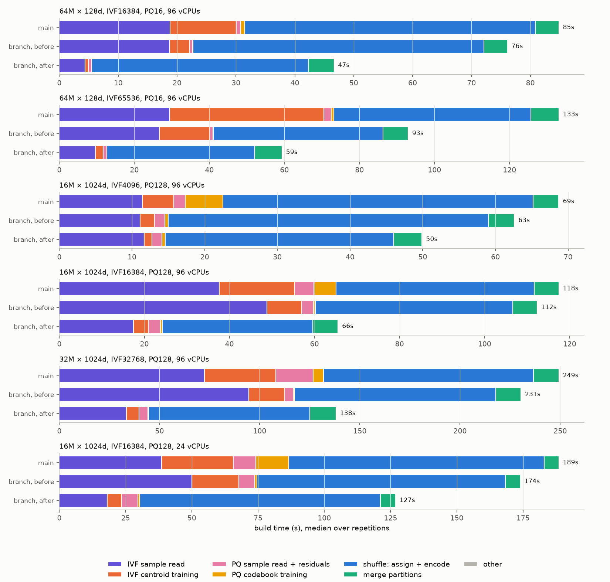
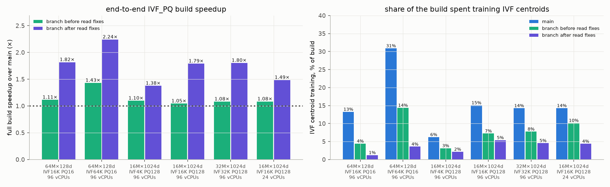

# Centroid training and full IVF_PQ builds

## Full IVF_PQ builds before and after the read path fixes

| configuration | variant | build (s) | speedup | IVF sample | IVF train | PQ prep | PQ train | shuffle | merge | peak RSS (GB) | recall@10 (nprobes, refine) |
|---|---|---|---|---|---|---|---|---|---|---|---|
| 64M × 128d, IVF16384, PQ16, 96 vCPUs | main (n=2) | 84.9 | 1.00× | 18.8 | 11.3 | 0.7 | 0.7 | 49.3 | 4.0 | 10 | 0.434 (64,0), 0.435 (256,0) |
| 64M × 128d, IVF16384, PQ16, 96 vCPUs | branch before read fixes (n=2) | 76.2 | 1.11× | 18.8 | 3.4 | 0.5 | 0.0 | 49.4 | 4.0 | 14 | 0.438 (64,0), 0.439 (256,0) |
| 64M × 128d, IVF16384, PQ16, 96 vCPUs | branch after read fixes (n=2) | 46.7 | 1.82× | 4.4 | 0.6 | 0.5 | 0.0 | 36.8 | 4.4 | 8 | 0.440 (64,0), 0.440 (256,0) |
| 64M × 128d, IVF65536, PQ16, 96 vCPUs | main (n=2) | 133.2 | 1.00× | 29.4 | 41.2 | 2.0 | 0.7 | 52.5 | 7.5 | 14 | 0.463 (256,0), 0.463 (1024,0) |
| 64M × 128d, IVF65536, PQ16, 96 vCPUs | branch before read fixes (n=2) | 93.1 | 1.43× | 26.7 | 13.4 | 0.9 | 0.0 | 45.2 | 6.8 | 12 | 0.465 (256,0), 0.465 (1024,0) |
| 64M × 128d, IVF65536, PQ16, 96 vCPUs | branch after read fixes (n=2) | 59.5 | 2.24× | 9.6 | 2.1 | 0.9 | 0.1 | 39.4 | 7.3 | 12 | 0.465 (256,0), 0.465 (1024,0) |
| 16M × 1024d, IVF4096, PQ128, 96 vCPUs | main (n=2) | 68.8 | 1.00× | 11.4 | 4.3 | 1.6 | 5.2 | 42.7 | 3.5 | 23 | 0.644 (16,0), 0.657 (64,0) |
| 16M × 1024d, IVF4096, PQ128, 96 vCPUs | branch before read fixes (n=2) | 62.6 | 1.10× | 11.1 | 2.0 | 1.5 | 0.4 | 44.1 | 3.5 | 23 | 0.643 (16,0), 0.654 (64,0) |
| 16M × 1024d, IVF4096, PQ128, 96 vCPUs | branch after read fixes (n=2) | 49.9 | 1.38× | 11.7 | 1.1 | 1.4 | 0.4 | 31.5 | 3.9 | 19 | 0.643 (16,0), 0.654 (64,0) |
| 16M × 1024d, IVF16384, PQ128, 96 vCPUs | main (n=2) | 117.6 | 1.00× | 37.6 | 17.7 | 4.6 | 5.2 | 46.6 | 5.8 | 22 | 0.643 (64,0), 0.645 (256,0) |
| 16M × 1024d, IVF16384, PQ128, 96 vCPUs | branch before read fixes (n=2) | 112.4 | 1.05× | 48.8 | 8.1 | 2.8 | 0.4 | 46.5 | 5.7 | 23 | 0.634 (64,0), 0.637 (256,0) |
| 16M × 1024d, IVF16384, PQ128, 96 vCPUs | branch after read fixes (n=2) | 65.6 | 1.79× | 17.5 | 3.5 | 2.8 | 0.4 | 35.3 | 6.0 | 22 | 0.643 (64,0), 0.646 (256,0) |
| 32M × 1024d, IVF32768, PQ128, 96 vCPUs | main (n=2) | 249.5 | 1.00× | 72.5 | 35.6 | 18.6 | 5.1 | 104.7 | 12.7 | 41 | 0.639 (128,0), 0.640 (512,0) |
| 32M × 1024d, IVF32768, PQ128, 96 vCPUs | branch before read fixes (n=2) | 230.6 | 1.08× | 94.6 | 17.9 | 4.5 | 0.4 | 100.4 | 12.6 | 40 | 0.639 (128,0), 0.640 (512,0) |
| 32M × 1024d, IVF32768, PQ128, 96 vCPUs | branch after read fixes (n=2) | 138.3 | 1.80× | 33.4 | 6.3 | 4.5 | 0.4 | 80.4 | 13.1 | 39 | 0.640 (128,0), 0.641 (512,0) |
| 16M × 1024d, IVF16384, PQ128, 24 vCPUs | main (n=2) | 188.6 | 1.00× | 38.6 | 26.9 | 8.6 | 12.4 | 96.3 | 5.6 | 21 | 0.636 (64,0), 0.639 (256,0) |
| 16M × 1024d, IVF16384, PQ128, 24 vCPUs | branch before read fixes (n=2) | 174.1 | 1.08× | 50.1 | 17.7 | 6.0 | 0.8 | 93.8 | 5.6 | 19 | 0.639 (64,0), 0.642 (256,0) |
| 16M × 1024d, IVF16384, PQ128, 24 vCPUs | branch after read fixes (n=2) | 127.0 | 1.49× | 18.0 | 5.5 | 6.0 | 0.7 | 90.8 | 5.8 | 20 | 0.639 (64,0), 0.641 (256,0) |

