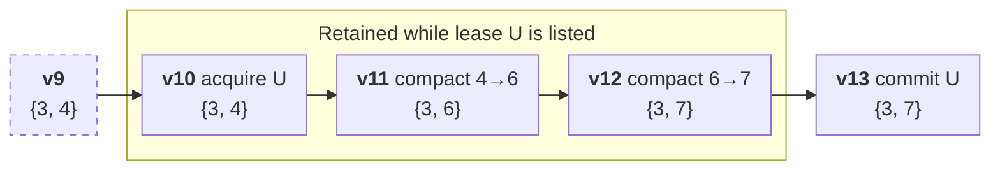

# Retention Leases

A **retention lease** keeps a version, and everything needed to reach the
current head from it, until a holder finishes work based on that version.
While a lease is listed in the current manifest:

1. Cleanup **must retain** every version from the leased version through the
   current head, including the files and transactions those versions need.
2. [Fragment Reuse Index](../index/system/frag_reuse.md) (FRI) trimming **must retain** the transitions that
   connect the leased version's fragments to the current layout.

This lets compaction and cleanup proceed while a holder spends hours or days
building an index or another result from the leased version. Unlike a tag, a
lease is temporary: it ends when the holder publishes its result, releases the
lease, or stops renewing it.



Each box shows a version, the commit that created it, and its fragment IDs.
Acquiring lease U creates version 10, the leased version. Cleanup may remove
version 9, but must keep versions 10 through the head. The holder reads
version 10 and later publishes its result in a transaction whose UUID is U.
Until then, FRI trimming must keep both compaction transitions so that results
computed against fragment 4 can be translated to fragment 7.

## Lease records

`Manifest.retention_leases` (field 27) stores the lease list. Only the current
manifest's list is authoritative; missing or empty means no leases. A lease is
**listed** while its record is in that list, including after it expires.

<details>
<summary>Lease protobuf message</summary>

```protobuf
%%% proto.message.lance.table.RetentionLease %%%
```

</details>

- `id` is the UUID of the transaction the holder intends to publish. It must
  differ from the acquisition transaction's own UUID, or the acquisition commit
  would release its own lease.
- `version` is the version created by the acquisition commit. The holder does
  not choose it: an older version's files or FRI transitions could already be
  removed or approved for deletion, but the newly created head cannot be.
- `created_at` and `expires_at` are absolute UTC times; expiration must be
  later than creation.
- `label` is optional, human-readable context with no retention meaning.

Writers **must reject** lists with incomplete records, invalid values, or
duplicate IDs. Writer flag 20 (`FLAG_RETENTION_LEASES`) **must be set exactly
when the list is nonempty**, so writers that do not support leases reject the
table only while leases exist. Readers may ignore the list.

## Lifecycle

Every commit **must derive the lease list from its predecessor**,
including on retry: remove records whose `expires_at` has passed, apply the
commit's own lease changes, and preserve the rest. A cached or historical list
is never used.

- **AcquireLease** adds a lease with `version` set to the version the commit
  creates. Its `expires_at` must be in the future. It is idempotent by ID: if
  the ID is already listed, it returns the stored record unchanged. The holder **must not read** the leased version until
  the acquisition commit succeeds, since a rebase can change which version it
  creates.
- **RenewLease** extends `expires_at` of a listed, unexpired lease. An absent or
  expired target is an error; a requested time not later than the current
  `expires_at` is a no-op.
- **ReleaseLease** removes a lease, for example when work is abandoned. An
  absent target is a no-op.
- **Publication**: an ordinary commit whose `Transaction.uuid`, parsed
  as a UUID, equals a listed lease ID removes that lease atomically with its
  operation. If no listed lease matches, the commit proceeds unchanged. Lease
  operations and Clone never release a lease this way, since they do not
  publish the holder's result.

A lease request whose derived list equals its predecessor's creates no
version. A request that would otherwise be a no-op still commits if it removes
expired records, so releasing an expired lease frees what it retained. An
expired lease remains listed, and still retains resources, until the next
commit removes it. Cleanup does not commit, so it never judges expiration by
its own clock.

## Retention

### Retained versions

Let F be the oldest leased version among listed leases and H the current head.
Cleanup **must retain every version from F through H**, together with all
files they reference.

The holder's publication must rebase over every commit after F, so each
commit while leases are listed **must record its [transaction](transaction.md)**,
and cleanup must retain the transactions of versions after F. If cleanup cannot
confirm that a required version or transaction is present, it **must not
delete** files that version might need.

Acquisition does not cancel deletions that cleanup approved before it.

### Unreferenced files

A holder's staged output, such as index segments, is unreferenced until
publication. While leases are listed, cleanup **must not delete** an
unreferenced file whose last-modified time is at or after the oldest listed
lease's `created_at`, less a margin for clock skew between writers and storage.

### Required transitions

The required transitions are found from the fragment IDs of each leased
version, using the [FRI history](../index/system/frag_reuse.md#fri-index-versions):

- **FRI version 1:** select each transition whose sources intersect the set, add
  its destination IDs, and repeat until no more transitions are selected. A
  selected legacy reuse version contributes every group's destinations.
- **Legacy-only FRI (`index_version = 0`):** retain reuse versions stamped at or
  after the oldest leased version. New reuse versions are stamped with their
  publishing version minus one, the version the rewrite was based on, which
  index catch-up already compares against an index's `dataset_version`.

FRI trimming **must retain** the union of the transitions required by listed
leases and by existing indices. Compaction **must record** the
transitions listed leases require, even when no index needs them. If the table
has no FRI, compaction creates one: at index version 1, which sets the sticky
`FLAG_FRAGMENT_REUSE_INDEX` reader and writer flags, or at index version 0 on
stable-row-ID tables, where index version 1 is not allowed. Every rewrite
or trim **must recheck** these requirements against its predecessor before
committing, including after conflicts.

## Other operations

- **Restore and overwrite** remove all leases. A holder's publication would
  conflict with them anyway.
- **New branches and clones** start with an empty lease list and therefore no
  flag 20.
- **Detached commits** neither carry nor change leases, and are outside the
  retention window.
- **Branch deletion** does not check leases; deleting a branch ends its leases.
